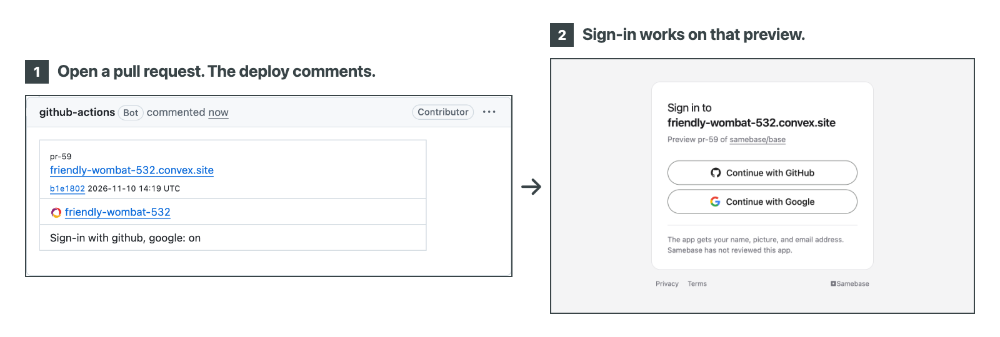
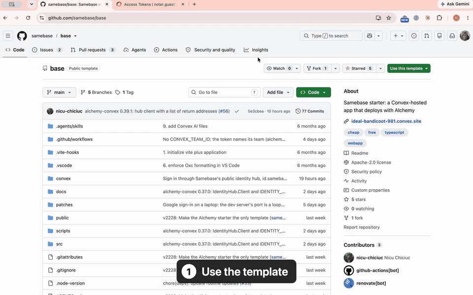

# base

**Google sign-in that works on every pull request preview.** A starter for apps on
[Convex](https://convex.dev), deployed by [Alchemy](https://alchemy.run) with one secret. No Google
Cloud project, no OAuth client, no Samebase account.



[**Use this template**](https://github.com/samebase/base/generate) ·
[Live demo](https://ideal-bandicoot-981.convex.site) ·
[The other parts](https://github.com/samebase)

## Start

1. **Use this template** and create your repository.
2. **Add one secret**, `CONVEX_ACCESS_TOKEN`: a team access token from the Convex dashboard (the
   team, **Settings**, **Access Tokens**). `gh secret set CONVEX_ACCESS_TOKEN` asks for the value
   without showing it.
3. **Push to `main`**, or run `alchemy` from the **Actions** tab. About a minute later the log ends
   with your URL, `https://<deployment>.convex.site`.

That is the whole setup. The first run creates the Convex project, named after the repository, and
its production deployment. From then on every push to `main` deploys, and every pull request gets a
preview deployment with its URL in a comment, deleted when the pull request closes.



If the team already has a project with the repository's name, such as one that `pnpm run dev`
created, the first run stops. Run it once with **adopt**: `gh workflow run alchemy.yml -f adopt=true`.

## The whole sign-in setup

Google wants each callback URL registered by hand, so a preview with a new URL cannot sign in. Here
each deployment is its own client at
[Samebase's identity broker](https://github.com/samebase/public-identity-broker),
`https://login.samebase.com`, with nothing registered and no secret: its client id is the address
of a file on its own site, `<site>/oauth-client.json`, that lists its callback URL.

Accounts live in your app: a user is `google:<id>`, and **Delete account** removes them. Guest
sign-in works without the broker. The broker offers Google only, for now.

## What is fixed, and what is yours

Two things are fixed:

- **Convex** runs the real-time backend and the database, and serves the app's files and its
  server-rendered pages through [convex-hosting](https://github.com/samebase/convex-hosting). There
  is no second host to set up or pay for.
- **[Alchemy](https://alchemy.run)** deploys it from one file, `alchemy.run.ts`, with
  [@samebase/alchemy-convex](https://github.com/samebase/samebase/tree/main/packages/alchemy-convex):
  `main` to the stage `prod`, each pull request to `pr-<number>`. No deploy key is stored anywhere;
  each run mints a short-lived one from the team token.

The rest is a starting point:

- **The interface** is React 19 with TanStack Start and shadcn/ui, with pages rendered on the
  server. It is the replaceable part: an agent can rewrite it for another framework.
- **Sign-in** is Convex Auth, with the session in an httpOnly cookie, so signed-in pages render on
  the server.
- **The example app** is a public todo list. Guests sign in with one click, see updates in real
  time, and scan a QR code to open the list on another device.
- **The tools** are Vite+ for dev, format, lint, test, and build, Node.js 24, and Renovate for the
  versions.

## Local development

Install the [Vite+](https://viteplus.dev/guide/) CLI, which installs the Node.js version from
`.node-version` with `vp env install`. Then:

```sh
corepack enable
pnpm install
pnpm run dev
```

`pnpm run dev` starts Convex and TanStack Start together on a cloud development deployment of this
checkout. A linked Git worktree gets its own.

**The first run on a fresh clone stops with an error.** That is expected: the deployment has no
Convex Auth keys and no server build yet. Once Convex has signed you in and written `.env.local`,
stop it and run `pnpm run deploy:dev` once. It creates the keys, uploads the build, and pushes. From
then on `pnpm run dev` works as usual.

The **Sign in** button works in development too, on the development deployment's site. See
[`docs/local-setup.md`](./docs/local-setup.md) for the details and troubleshooting on macOS, Linux,
and Windows.

| Command               | Purpose                                               |
| --------------------- | ----------------------------------------------------- |
| `pnpm run check`      | Format, lint, type-check, and test                    |
| `pnpm run build`      | Run the checks and build the app into `dist/client`   |
| `pnpm run deploy:dev` | Build, upload, and push to the development deployment |
| `pnpm run deploy`     | Build, upload, and push to production                 |

## Learn more

- [How deploys work](./docs/deploys.md): the stages, the state store, local `alchemy deploy`, and
  renaming an old `main` stage to `prod`.
- [Google sign-in](./docs/google-sign-in.md): the broker, `/oauth-client.json`, development, the
  broker's terms, and how to run your own broker.
- [Files](./docs/files.md): where things are, and which files are generated.

## License

[MIT](./LICENSE). Copy it, change it, ship it; keep the copyright line. See
[`THIRD_PARTY_NOTICES.md`](./THIRD_PARTY_NOTICES.md) for
included third-party material.
