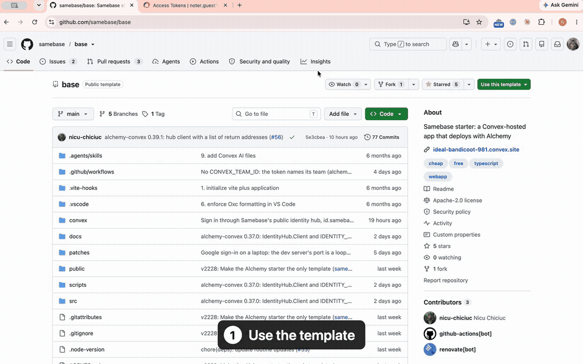

# Samebase base

One secret, one push: a React app on Convex with Google sign-in, pull request previews, and a
real-time backend, in your own Convex team. No Samebase account.



[**Use this template**](https://github.com/samebase/base/generate) ·
[Live demo](https://ideal-bandicoot-981.convex.site) ·
[How sign-in works](https://github.com/samebase/identity-hub#readme) ·
[samebase.com](https://samebase.com)

## Start

1. **Use this template** and create your repository.
2. **Add one secret**, `CONVEX_ACCESS_TOKEN`: a team access token from the Convex dashboard (the
   team, **Settings**, **Access Tokens**). `gh secret set CONVEX_ACCESS_TOKEN` asks for the value
   without showing it.
3. **Push to `main`**, or run `alchemy` from the **Actions** tab. About a minute later the log ends
   with your URL, `https://<deployment>.convex.site`.

That is the whole setup. The first run creates the Convex project, named after the repository, and
its production deployment. From then on every push to `main` deploys, and every pull request gets a
preview deployment with its URL in a comment, deleted when the pull request closes.

**Sign in with Google** works on the first deploy. The run registers its own sign-in client at
[Samebase's identity hub](https://github.com/samebase/identity-hub) with GitHub's token of the run,
so you create no Google project and no account anywhere. Accounts live in your app: a user is
`google:<id>`, and **Delete account** removes them.

If the team already has a project with the repository's name, such as one that `pnpm run dev`
created, the first run stops. Run it once with **adopt**: `gh workflow run alchemy.yml -f adopt=true`.

## What you get

- **React 19 and TanStack Start**, with pages rendered on the server, and shadcn/ui.
- **Convex** for the real-time backend and database, and Convex Auth for guest sign-in and Google
  sign-in, with the session in an httpOnly cookie, so signed-in pages render on the server.
- **One host.** The Convex deployment serves the app's files too, through
  [convex-hosting](https://github.com/samebase/convex-hosting). There is no second service to set
  up or pay for.
- **Deploys with [Alchemy](https://alchemy.run)** and
  [@samebase/alchemy-convex](https://github.com/samebase/samebase/tree/main/packages/alchemy-convex):
  `main` to the stage `prod`, each pull request to `pr-<number>`. No deploy key is stored anywhere;
  each run mints a short-lived one from the team token.
- **An example app**: a public todo list. Guests sign in with one click, see updates in real time,
  and scan a QR code to open the list on another device.
- **Vite+** for dev, format, lint, test, and build. Node.js 24. Renovate keeps the versions fresh.

The same app without Alchemy is [samebase/base-hosting](https://github.com/samebase/base-hosting).

## Local development

Install the [Vite+](https://viteplus.dev/guide/) CLI, which installs the Node.js version from
`.node-version` with `vp env install`. Then:

```sh
corepack enable
pnpm install
pnpm run dev
```

`pnpm run dev` starts Convex and TanStack Start together on a cloud development deployment of this
checkout. A linked Git worktree gets its own.

**The first run on a fresh clone stops with an error.** That is expected: the deployment has no
Convex Auth keys and no server build yet. Once Convex has signed you in and written `.env.local`,
stop it and run `pnpm run deploy:dev` once. It creates the keys, uploads the build, and pushes. From
then on `pnpm run dev` works as usual.

For the **Sign in** button in development, after the first deploy to `main`, run
`pnpm run identity-hub:dev-client --stage dev-<your name>` once. It gives the development deployment
its own hub client. See [`docs/local-setup.md`](./docs/local-setup.md) for the details and
troubleshooting on macOS, Linux, and Windows.

| Command                            | Purpose                                               |
| ---------------------------------- | ----------------------------------------------------- |
| `pnpm run check`                   | Format, lint, type-check, and test                    |
| `pnpm run build`                   | Run the checks and build the app into `dist/client`   |
| `pnpm run deploy:dev`              | Build, upload, and push to the development deployment |
| `pnpm run identity-hub:dev-client` | Give the development deployment a hub client (Google) |
| `pnpm run deploy`                  | Build, upload, and push to production                 |

## Learn more

- [How deploys work](./docs/deploys.md): the stages, the state store, local `alchemy deploy`, and
  renaming an old `main` stage to `prod`.
- [Google sign-in](./docs/google-sign-in.md): the hub, `/samebase-verification.json`, apps on other
  hosts, the hub's terms, and how to run your own hub.
- [Files](./docs/files.md): where things are, and which files are generated.

## License

[MIT](./LICENSE). Copy it, change it, ship it; keep the copyright line. See
[`THIRD_PARTY_NOTICES.md`](./THIRD_PARTY_NOTICES.md) for
included third-party material.
